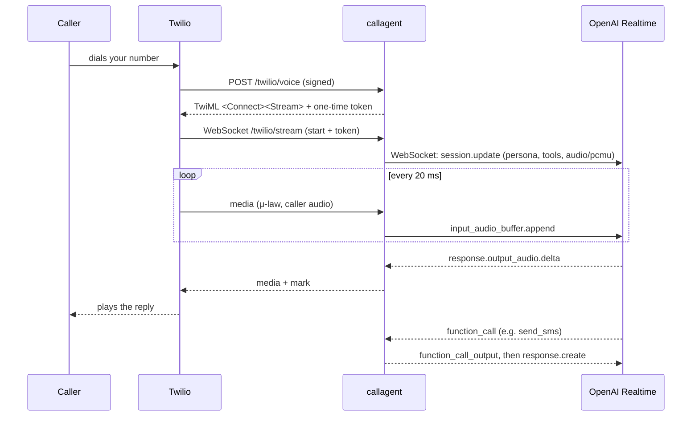
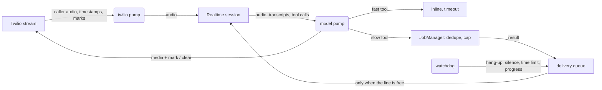

# realtime-call-agent

**A real-time AI phone agent.** Call a Twilio number and talk to a speech-to-speech model
(OpenAI Realtime) that answers in well under a second, can be interrupted mid-sentence, runs
slow tasks in the background while it keeps talking, and can phone other people on your
behalf and report back.

[](https://github.com/ashartanveercs-del/realtime-call-agent/actions/workflows/ci.yml)


```text
Owner:  "Hey, can you call the bakery and check if my cake is ready, and text Alex I'm running late?"
Agent:  "Sure - I'll text Alex first. 'Running about 15 minutes late' - send that?"
Owner:  "Yep."
Agent:  "Sent. I'm calling the bakery now; I'll tell you what they say."
        ... (a second call happens in the background while you keep chatting) ...
Agent:  "The bakery says your cake is ready and they're open until 7."
```

## What's inside

| | |
|---|---|
| **Speech-to-speech, no transcoding** | Twilio Media Streams deliver G.711 μ-law at 8 kHz; the Realtime API accepts and emits the same format (`audio/pcmu`), so audio frames are relayed untouched in both directions. |
| **Barge-in that matches what was heard** | When the caller interrupts, playback is flushed and the model's memory is truncated to the exact millisecond the caller actually heard, not what was sent. |
| **Two-speed tools** | Fast tools answer inline. Slow ones run as background jobs, deduplicated and capped, so the conversation never stalls. Their results are spoken only when the caller can hear them. |
| **Outbound "missions"** | `call_person` (or `POST /calls`) phones someone to pursue a goal. The callee leg is its own AI session; its transcript comes back as the result. |
| **Caller roles** | Owner, guest and mission callers each get a different persona and a different set of tools. Guests can only leave a message, which is relayed to you by SMS. |
| **Secure by default** | Twilio webhook signatures are verified, streams are bound by one-time tokens, and owner mode can require STIR/SHAKEN attestation. Tool access is checked server-side and errors are never read aloud. |
| **Call hygiene** | Silence gets a nudge and then a goodbye. There's a hard time limit, hang-up waits for the goodbye to finish playing, and long tasks get progress updates. |
| **Observability** | Every call writes a JSONL transcript and a summary with token usage and an optional cost estimate. |
| **Tested without a phone** | 95 tests drive whole calls through in-memory fakes of Twilio and the model, covering barge-in, background jobs, hang-ups, missions and the HTTP layer. |

## Architecture



Each call runs three concurrent loops ([`session.py`](src/callagent/session.py)):



### The parts that are harder than they look

**1. Truncating to what the caller heard.** The model streams audio much faster than real
time, so "bytes sent" overstates what was played. Twilio's inbound frames carry a
stream-clock timestamp. Audio heard is therefore `min(audio sent, playback time elapsed since
the item's first chunk)` ([`audio.py`](src/callagent/audio.py)). On barge-in the session
sends Twilio a `clear` and the model a `response.cancel`, then a `conversation.item.truncate`
at that position. If the caller heard a meaningful chunk, it adds a short system note so the
model knows it was cut off and doesn't repeat itself.

**2. One response at a time.** The Realtime API allows a single in-flight response. Every
response the agent wants (tool follow-ups, background results, nudges, wrap-ups) goes through
one queue. That queue waits while a response is generating or the caller is talking. When the
server starts a turn on its own, queued plain "please respond" requests are dropped, because
that turn already sees the new context. Background results are inserted as system notes and
spoken only when the line is free.

**3. Knowing when audio has actually played.** After each audio chunk the agent sends a Twilio
`mark`; Twilio echoes it once playback reaches it. Pending marks mean audio is still queued on
the line. End-of-call waits for them so the goodbye isn't cut off, and barge-in uses them to
decide whether there is anything to interrupt.

**4. Identity can't come from the stream.** The incoming-call webhook is signature-verified,
so it decides the caller's role and mints a single-use token. The token goes inside the TwiML
`<Stream>` parameters. A WebSocket without an unused, unexpired token is hung up before any
model session opens.

## Quick start

Requirements: Python 3.11+, a Twilio phone number, an OpenAI API key with Realtime access, and
a public HTTPS URL that reaches your machine (e.g. `ngrok http 8080` or `cloudflared tunnel`).

```bash
git clone https://github.com/ashartanveercs-del/realtime-call-agent
cd realtime-call-agent
python -m venv .venv && source .venv/bin/activate     # Windows: .venv\Scripts\activate
pip install -e ".[dev]"
cp .env.example .env                                  # fill in keys, numbers and PUBLIC_BASE_URL
python -m callagent --env-file .env
```

In the Twilio console, set your number's **"A call comes in"** webhook to
`POST https://<your-public-host>/twilio/voice`. Call the number.

Or with Docker: `docker compose up --build`.

### Make an outbound call

```bash
curl -X POST https://<your-public-host>/calls \
  -H "Authorization: Bearer $API_TOKEN" -H "Content-Type: application/json" \
  -d '{"to": "+15551234567", "goal": "Ask whether my order #4411 has shipped."}'
# -> {"mission_id": "m_...", "status": "dialing", ...}

curl -H "Authorization: Bearer $API_TOKEN" https://<your-public-host>/calls/m_...
# -> {"status": "completed", "outcome": "Them: It shipped this morning...\nRobin: ..."}
```

Unanswered, busy or failed calls are reported through Twilio's status callback, so a mission
never waits forever.

## Built-in tools

| Tool | Roles | Speed | What it does |
|---|---|---|---|
| `end_call` | all | fast | Hangs up after the goodbye has finished playing |
| `current_time` | all | fast | Local date and time in `TIMEZONE`, phrased for speech |
| `take_message` | guest | fast | Saves the message and texts it to the owner |
| `send_sms` | owner | fast | Texts a contact or number, after confirming wording with the owner |
| `call_person` | owner | background | Places a mission call and reports what was said |
| `delegate_task` | owner | background | Hands any task to your own agent over a webhook (enabled when `AGENT_WEBHOOK_URL` is set) |

### Add your own

```python
from callagent.builtin_tools import build_registry
from callagent.server import create_app

registry = build_registry(settings)

@registry.tool(description="Check an order's delivery status.", roles=("owner", "guest"),
               parameters={"type": "object", "required": ["order_id"],
                           "properties": {"order_id": {"type": "string"}}})
async def order_status(ctx, order_id):
    return {"ok": True, "status": "out for delivery", "eta": "today 4-6 PM"}

app = create_app(settings, registry=registry)
```

Pass `background=True` for anything that takes more than a couple of seconds, and give it a
`label` so progress updates sound natural. Return `ToolResult(..., respond=False)` when the
model shouldn't speak after the tool. A runnable example is in
[`examples/custom_tools.py`](examples/custom_tools.py).

### Plug in your own agent

With `AGENT_WEBHOOK_URL` set, the owner can ask for anything ("what's on my calendar
tomorrow?") and the request is POSTed to your agent as `{"task", "caller", "call_sid"}` with
`Authorization: Bearer $API_TOKEN`. Respond with `{"answer": "..."}`; it's spoken when ready. A
minimal server is in [`examples/agent_webhook.py`](examples/agent_webhook.py). Put LangGraph,
the OpenAI Agents SDK, the Claude Agent SDK or anything else behind it.

## Configuration

| Variable | Default | |
|---|---|---|
| `OPENAI_API_KEY` | required | |
| `TWILIO_ACCOUNT_SID` / `TWILIO_AUTH_TOKEN` / `TWILIO_PHONE_NUMBER` | required | |
| `PUBLIC_BASE_URL` | required | `https://...` that Twilio can reach |
| `REALTIME_MODEL` | `gpt-realtime-2.1-mini` | any Realtime speech-to-speech model |
| `REALTIME_VOICE` | `marin` | |
| `TRANSCRIPTION_MODEL` | `whisper-1` | empty to disable transcripts |
| `AGENT_NAME` / `OWNER_NAME` | `Robin` / `the owner` | used in personas |
| `OWNER_NUMBERS` | — | comma-separated E.164 numbers that get owner mode |
| `OWNER_REQUIRE_ATTESTATION` | `false` | owner mode only with STIR/SHAKEN `TN-Validation-Passed-A` (US/France) |
| `API_TOKEN` | — | enables `/calls`; also sent to your agent webhook |
| `AGENT_WEBHOOK_URL` | — | enables `delegate_task` |
| `CONTACTS_FILE` | — | JSON map of names to numbers ([example](examples/contacts.example.json)) |
| `TIMEZONE` | `UTC` | |
| `MAX_CALL_SECONDS` | `900` | |
| `SILENCE_NUDGE_SECONDS` / `SILENCE_END_SECONDS` | `30` / `75` | |
| `MAX_BACKGROUND_JOBS` | `3` | per call |
| `COST_PER_MTOK` | — | e.g. `input_audio=..,output_audio=..,input_text=..,output_text=..,cached=..` (USD per 1M tokens, from current pricing) |
| `DATA_DIR` | `data` | transcripts, summaries, messages |
| `VALIDATE_TWILIO_SIGNATURE` | `true` | only disable for local experiments |

## Testing

```bash
pytest            # 95 tests, ~2 s, no network or phone needed
ruff check src tests
```

[`tests/fakes.py`](tests/fakes.py) provides in-memory sockets for the Twilio stream and the
model, so tests can script exact event orders. One test, for example, checks that an
interruption 600 ms into a 2-second reply truncates the model's memory at exactly 600 ms.
HTTP routes are tested with real Twilio signatures, and the Realtime connector is tested
against a local WebSocket server.

## Security notes

- **Caller ID can be spoofed.** `OWNER_NUMBERS` alone is convenient but not proof of identity.
  Use `OWNER_REQUIRE_ATTESTATION=true` where STIR/SHAKEN is available, and keep owner-only
  tools to actions you're comfortable gating that way.
- Guests only ever see guest tools. The model can't call a tool outside the caller's role even
  if it hallucinates the name.
- Tool failures return a generic message and are logged with details. Internal errors are never
  spoken.

## Responsible use

Outbound calls open by saying they come from an AI assistant calling on your behalf. Follow the
consent, telemarketing and call-recording laws where you and the people you call live (for
example, the TCPA in the US). Don't use this for unsolicited or bulk calling.

## Roadmap

- SIP mode for speech-to-speech models that terminate SIP directly, removing the media relay
- Pluggable memory (per-caller context via the `context_provider` hook)
- WebRTC / browser client alongside the phone line
- Multi-language voice and auto language detection

## License

MIT
